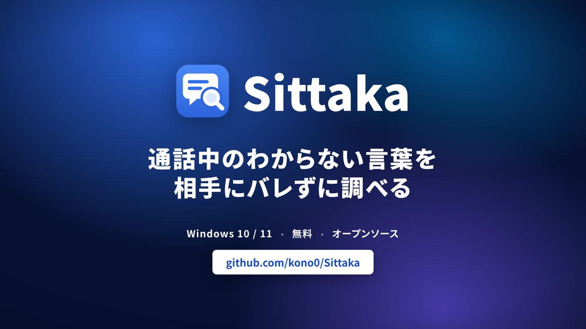
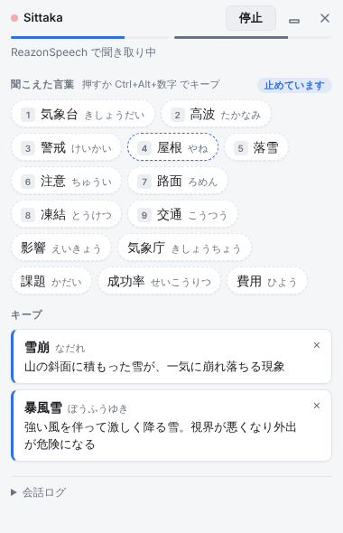
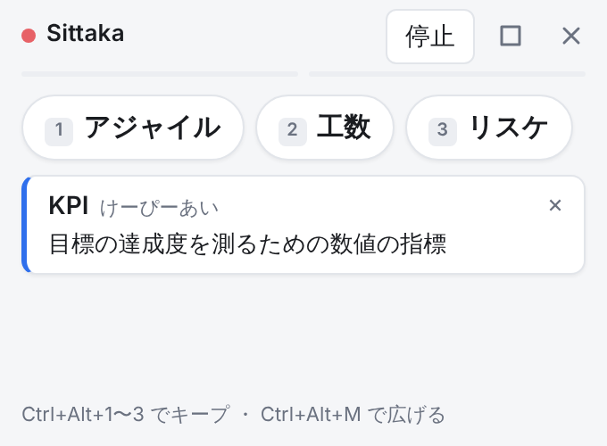
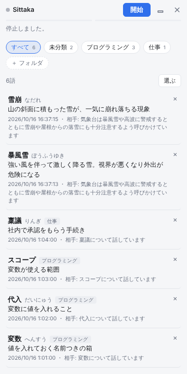
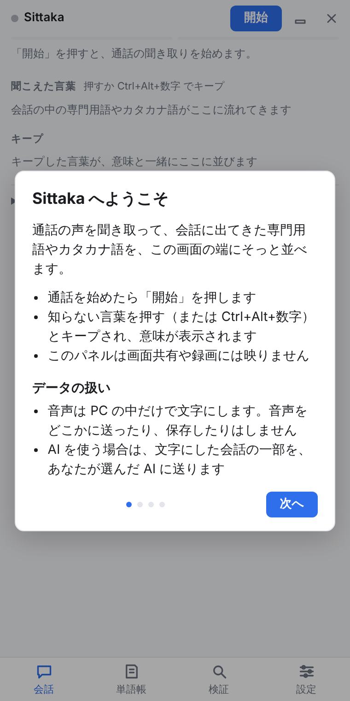
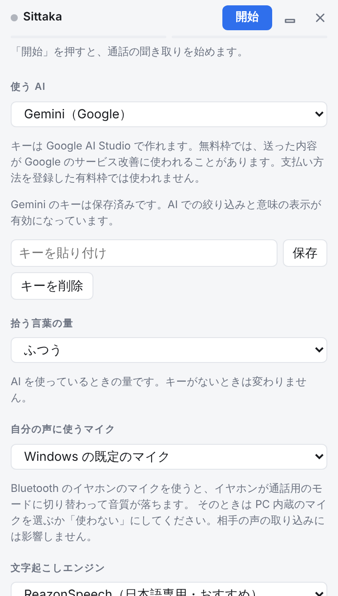

<p align="center">
  
</p>

<p align="center">
  <a href="https://github.com/kono0/Sittaka/releases/latest"></a>
</p>

<p align="center">Windows 10 / 11（64ビット）・ 無料 ・ Mac 版は準備中</p>

---

## Sittaka って？

オンライン通話（Zoom・Teams・Discord など）で、**知らない言葉が出てきても、相手にバレずにその場で意味を確かめられる**アプリです。

1. 通話の声を、PC の中で自動で文字にします
2. 会話に出てきた専門用語・カタカナ語・略語を、画面の端のパネルに並べます
3. 気になる言葉を押すと、**その会話の流れに合った意味が一文で**出ます

パネルは**画面共有や録画には映りません**。

| 会話中の画面 | 小さくたたんだ画面 | あとで見返せる単語帳 |
| :---: | :---: | :---: |
|  |  |  |
| 上に「聞こえた言葉」、下に押した言葉の意味 | 画面の右上に小さく置いておける | 意味とそのときの会話が残る。フォルダで整理できる |

---

## はじめかた

### 1. ダウンロードしてインストール

1. 上の **「Windows 版をダウンロード」** を押し、開いたページの「Assets」にある **`Sittaka-Setup-（版の番号）.exe`** をダウンロードします
2. ダウンロードしたファイルを開きます
3. 「Windows によって PC が保護されました」と出たら、**「詳細情報」→「実行」** を押します
   （個人で作っているアプリで、有料の署名をしていないために出る表示です）

新しい版が出たときは、アプリを起動したときに自動で更新されます。

### 2. はじめの案内にそって準備する



初めて起動すると、案内が出ます。順に進めるだけで準備が終わります。

1. 使い方とデータの扱いの説明
2. 声を文字にするための部品（約160MB）のダウンロード（最初の1回だけ。うまく取れないときは約700MBのまとめたファイルから取り出すので、通信量に余裕のある回線で行ってください）
3. 自分の声を拾うマイクの選択
4. AI のキーの入力（あとからでも OK）

AI のキーがなくても、言葉を並べるところまでは使えます。
**言葉の意味を表示するには AI のキーが必要**です（下の「AI のキーについて」を見てください）。

<br clear="right" />

### 3. 通話を始めたら「開始」を押す

あとは通話するだけです。

- 知らない言葉が並んだら、**押すとキープ**されて、下に意味が出ます
- キーボードの **Ctrl + Alt + 数字** でもキープできます（言葉の左の小さな数字）。通話アプリを前面にしたままで使えます
- 言葉の一覧にマウスを乗せている間は、並びが止まるので押しやすくなります

| キー | できること |
| --- | --- |
| Ctrl + Alt + 1〜9 | 上から N 番目の言葉をキープ |
| Ctrl + Alt + M | 小さな帯にする ・ 元に戻す |
| Ctrl + Alt + H | パネルを隠す ・ 出す |

---

## AI のキーについて



言葉の意味を出すために、AI を使います。Sittaka は会社のサーバーを持たないので、**自分で AI のキー（API キー）を取って、アプリに入れる**しくみです。

「設定」タブで、使う AI を次の 3 つから選べます。

| AI | キーを作る場所 | 料金の目安 |
| --- | --- | --- |
| Gemini（Google） | Google AI Studio | 無料枠あり |
| Sarashina（SB Intuitions） | Sarashina の開発者向けページ | 無料ベータ中 |
| Claude（Anthropic） | Claude Console | 使った分だけ |

- キーは PC の中に暗号化して保存します
- **無料枠では、送った内容が AI の学習に使われることがあります。** 仕事の会話で使うときは、有料のプランをおすすめします

<br clear="right" />

---

## よくある質問

<details>
<summary><b>通話の相手にバレませんか？</b></summary>

パネルは画面共有や録画に映らないようにしています。通話アプリには何も変更を加えないので、相手側から Sittaka を使っていることは分かりません。
</details>

<details>
<summary><b>声は録音されたり、どこかに送られたりしますか？</b></summary>

されません。声を文字にするのは PC の中だけで行い、音声をインターネットに送ったり、ファイルとして保存したりはしません。

AI のキーを入れたときだけ、**文字にした会話の一部**と調べる言葉を、自分で選んだ AI に送ります。くわしくは [プライバシーポリシー](PRIVACY.md) を見てください。
</details>

<details>
<summary><b>お金はかかりますか？</b></summary>

アプリは無料です。AI のキーの料金は、選んだ AI の会社に払います（Gemini と Sarashina は無料で試せます）。
</details>

<details>
<summary><b>どの通話アプリで使えますか？</b></summary>

PC から出る音をそのまま聞き取るので、Zoom・Teams・Discord・Google Meet など、通話アプリを選びません。
ただし、動画などほかの音も文字になります。
</details>

<details>
<summary><b>自分の声が二重に出る・音質が落ちる</b></summary>

- スピーカーで聞いていると、マイクが相手の声も拾うことがあります。**イヤホンがおすすめ**です
- Bluetooth のイヤホンのマイクを使うと、イヤホンの音質が落ちることがあります。「設定」の「自分の声に使うマイク」で、PC 内蔵のマイクか「使わない」を選んでください
</details>

<details>
<summary><b>漢字がときどき違う</b></summary>

声を文字にする部品（ReazonSpeech）の限界で、同じ読みの別の漢字になることがあります。AI のキーを入れていると、一部は AI が直します。
</details>

<details>
<summary><b>不具合を見つけた・こうしてほしい</b></summary>

[こちら（Issues）](https://github.com/kono0/Sittaka/issues) から教えてください。
</details>

---

## 開発者向け

<details>
<summary>ソースコードから動かす・配布する・中身の構成</summary>

### ソースコードから動かす（Windows）

[Node.js](https://nodejs.org/ja)（LTS）と [Git](https://git-scm.com/download/win) を入れて、PowerShell で次を実行します。

```powershell
git clone https://github.com/kono0/Sittaka.git
cd Sittaka
npm install
npm run dev
```

`npm run dev` で「Electron uninstall」と出たときは、`node node_modules/electron/install.js` を一度実行してから、もう一度 `npm run dev` してください。

```sh
npm run dev        # 開発モードで起動
npm run test       # 単体テスト
npm run typecheck  # 型チェック
npm run build      # ビルド
npm run dist       # Windows 用インストーラーを dist/ に作る（Windows で実行）
```

### 配布（リリース）

1. `package.json` の `version` を上げてコミットする
2. GitHub の Actions タブで「Release」を選び「Run workflow」を押す（`package.json` と同じ番号のタグ、たとえば `v0.2.0` を push してもよい。番号が違うと止まる）
3. GitHub Actions が Windows 用インストーラーを作り、Releases に下書きとして載せる
4. Releases で下書きを確かめて「公開」にすると、ダウンロードできるようになり、入れている人のアプリも次の起動で自動アップデートする

### 文字起こしエンジン

標準は ReazonSpeech です。設定で切り替えられます。モデルは初回だけダウンロードします。

| 選択肢 | 大きさ | 想定 |
| --- | --- | --- |
| ReazonSpeech（おすすめ） | 約160MB | 日本語専用。CPU だけで会話の10倍以上の速さで処理できる |
| Whisper base | 約80MB | 軽い。精度は低め |
| Whisper small | 約250MB | 中くらい |
| Whisper large-v3-turbo | 約500MB | 高精度。内蔵グラフィックでは遅い可能性あり |

Whisper は短い発話でも30秒分の計算をする仕組みのため、内蔵グラフィックの PC では会話に追いつけませんでした。比較用に残しています。

### AI のモデル

| AI | 速いほう（言葉の絞り込み） | 賢いほう（意味の説明） | 1分あたりの上限（アプリ側） |
| --- | --- | --- | --- |
| Sarashina | sarashina3-nano | sarashina3-mini | 60回・6回 |
| Gemini | gemini-flash-lite-latest | 同じ | 15回 |
| Claude | claude-haiku-5-5 | 同じ | 50回 |

上限を超えないよう、呼び出しの間隔をあけています。混んでいるときは AI を通さず規則だけの結果を出します。

### 「検証」タブ

発言ごとに「文字起こし → 単語への区切り → 候補 → AI の判断 → 結果」を確かめられます。文を入力して音声なしで試したり、「記録を保存（JSON）」で書き出したりできます。

### 構成

- `src/main` — ウィンドウの作成と、マイク・再生音の取り込み許可
- `src/main/asr` — ReazonSpeech（sherpa-onnx）のモデル取得と、別プロセスでの文字起こし
- `src/main/terms` — kuromoji で形態素解析し、調べる候補の言葉を抜き出す規則
- `src/main/ai` — AI（Sarashina・Gemini・Claude）の呼び出し（絞り込み・意味の説明）
- `src/main/settings.ts`・`src/main/wordbook.ts` — API キーと単語帳の保存
- `src/renderer/src/words` — 聞こえた言葉とキープの一覧
- `src/renderer/src/audio` — 音声の取り込みと発話の区切り（VAD）
- `src/renderer/src/asr` — 文字起こしエンジン（`Transcriber` を実装すれば差し替え可能）

</details>

## ライセンス

MIT ライセンスです。使っているソフトウェアのライセンス表記は、アプリの「設定」から開けます。
